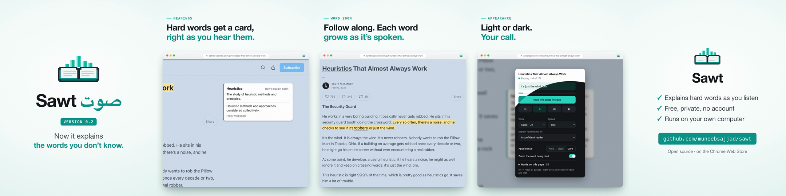

# demo-reel

Product demo videos made by an agent. It records the real product in a browser, then frames it in
a clean window, moves a camera to what matters, adds captions, title and end cards, and renders an
MP4 ready to post: no video editor, no timeline.

[](https://github.com/muneebsajjad/demo-reel/actions/workflows/ci.yml)



*Frames from [`examples/sawt`](examples/sawt): a 31-second LinkedIn video for
[Sawt](https://github.com/muneebsajjad/sawt), recorded and edited end to end by Claude Code.
[Watch it](https://github.com/muneebsajjad/demo-reel/releases/download/v0.1.0/sawt-0.2-example.mp4).*

It is a [Claude Code skill](https://docs.claude.com/en/docs/claude-code/skills): you tell the agent
what to show, and it writes the scenario, records takes, writes the edit, checks stills and renders.
The tools also work by hand.

## How it works

```
scenario.mjs ──▶ reel take ──▶ take.mov + take.json ──▶ edit.json ──▶ reel render ──▶ demo.mp4
 the steps        Chrome for     picture and the         scenes, shots,   layers + camera
 a user takes     Testing +      app's own sound;        captions, brand  + captions + sound
                  recorder       events and element
                                 positions
```

- **`recorder/`** — a small Swift tool on ScreenCaptureKit. Records one app's windows and that
  app's sound only; nothing else on your screen or speakers gets in.
- **`drive/`** — runs a scenario in Chrome for Testing (with your unpacked extension, if any),
  records it, and logs every marked event and element position against the recording clock.
- **`layers/`** — HTML templates for the window frame, captions, key toasts, title and end cards,
  rendered by Chrome with your brand colours and logo.
- **`compose/`** — the compositor: crops the 2x recording through an eased camera, lays the overlays
  on, dissolves between scenes, cuts the sound with the picture and normalises it. It renders in
  parallel chunks (about 3 minutes for 30 seconds of 4:5 on a 6-core laptop; `--draft` for previews).
- **`qa/`** — where the sound is (to cut in pauses), contact sheets, length and loudness.
- **Formats and subtitles** — one edit renders 4:5, 1:1, 9:16 and 16:9; what is said is
  transcribed locally into an editable `.srt`, exported with every render and optionally burned in.
- **Music** — ships with a small CC0 library ([library/](library/README.md), 7 tracks, 7.4 MB) and
  picks a bed that suits the video by default (its pace, speech and captions against
  each track's measured tempo, energy and steadiness), or uses your own. Every track's licence is
  recorded and checked, the credit line to publish is written for you, and candidates can be
  auditioned under a finished render in seconds ([docs/music.md](docs/music.md)).

## Install

Requirements: macOS 15+ for recording, Xcode command line tools, Node 20+, Python 3.11+ with
[uv](https://docs.astral.sh/uv/), ffmpeg, Google Chrome.

```bash
git clone https://github.com/muneebsajjad/demo-reel ~/.claude/skills/demo-reel
~/.claude/skills/demo-reel/bin/reel setup
```

Give your terminal **Screen & System Audio Recording** permission (System Settings → Privacy &
Security), then restart it.

## Use

With Claude Code, ask for it: *"Make a 30-second demo video of my extension showing X, Y and Z."*
The skill (`SKILL.md`) takes it from there.

By hand, following the example:

```bash
export PATH="$HOME/.claude/skills/demo-reel/bin:$PATH"
cd ~/.claude/skills/demo-reel/examples/sawt
./prepare.sh /path/to/sawt/extension     # a recording copy of the extension
reel take scenario.mjs takes/take1       # record (Sawt's engine must be running)
reel speech takes/take1.mov              # where the sound is, to cut in pauses
reel layers edit.json                    # captions, cards, frame
reel stills edit.json 1,4,9,14           # check framing before rendering
reel render edit.json renders/sawt.mp4
reel sheet renders/sawt.mp4 1,4,9,14,20,26,30
```

`docs/edit-format.md` documents the edit file; `docs/lessons.md` is what went wrong the first time
and how the tools now avoid it.

## Development

```bash
reel doctor                              # is this machine ready?
uv run --group dev pytest -q             # unit tests and an end-to-end render (needs ffmpeg and Chrome)
reel check examples/sawt/edit.json       # an edit's problems, before rendering
```

CI runs the tests on Linux and builds the recorder on macOS for every push.

## Status

Early, and grown from one real video. It does browser products on macOS well. Next, as real
products need them:

- desktop apps (an accessibility-scripting driver; the recorder already takes any `--app`)
- a tested local music generator (ACE-Step)
- voiceover from text, for products that make no sound
- more card and transition templates

Contributions welcome: open an issue with the product you want to demo and what got in the way.

## License

MIT
